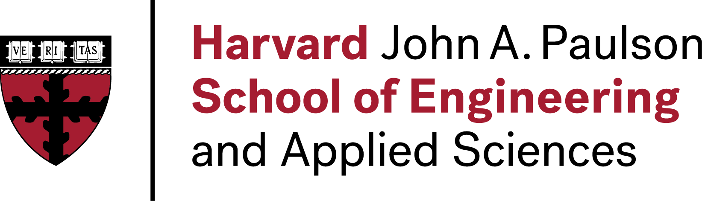
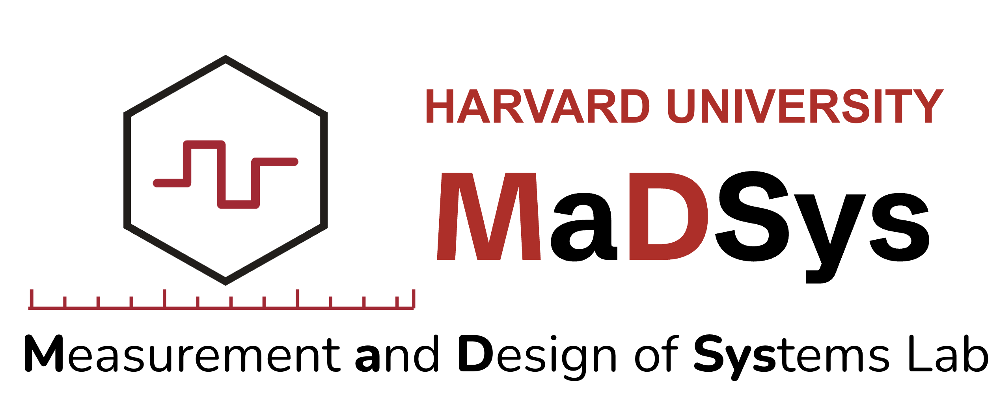
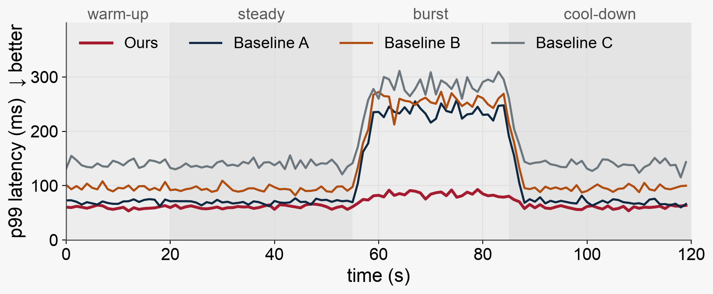
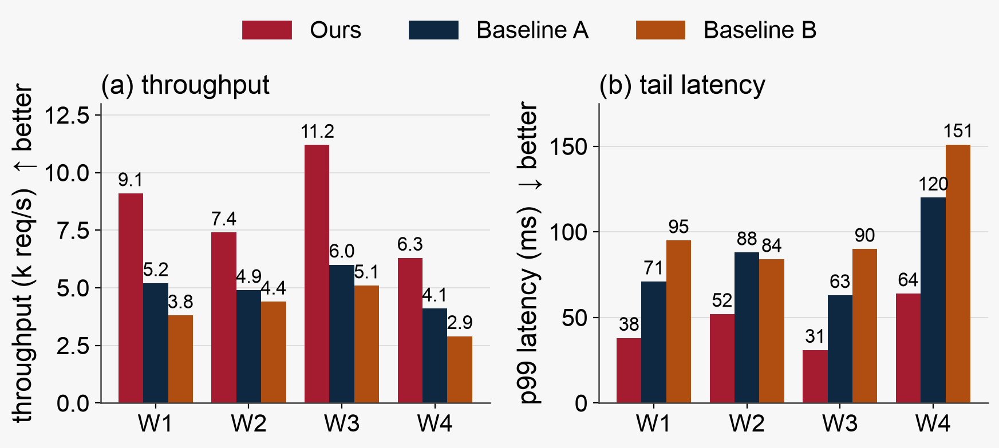

<!-- _class: title -->

# Your awesome title

### A subtitle

Your name

 

---

## Content

- Please use illustrations
- **Background**: what the audience needs to know
- **Motivation**: where today's systems fall short
- **Design**: the overview, the key component, a walk-through
- **Evaluation**: the headline result, and why it holds

---

## Background: necessary knowledge

- Please use illustrations
- Assume the audience is an undergraduate in computer science
- Tell people anything they need to know about this talk

<b>Tail latency</b> The 99th-percentile request latency (p99): one request in a hundred is slower.

---

## Motivation: gap

- Provide today's landscape (state-of-the-art)
  - What people have done
  - Where they fall short
  - Why they do not work
- Show numbers and figures

---

<!-- _class: compact -->

## Today's systems fall over under bursts

- **Bursts** triple the p99 latency of every baseline
- **Ours** stays within 1.4× of its steady-state p99

Burst: 55–88 s, at 1.8× the steady-state request rate.
Footnotes sit at the bottom of the slide, numbered in the order of the marks.

---

<!-- _class: divider -->
# Design

Overview, key component, and a walk-through

---

## Design 1

- Give an overview
- Different components in the system
- How they interact with each other
  - <mark>Highlight</mark> the one term the audience must keep in mind

---

## Design 2

- Focus on the key component
- Use illustrations with animation
  - Marp has no animations: build the figure up over consecutive slides

---

## Design 3

- Walk through a request / an example
  1. The client sends a request
  2. The scheduler places it on a worker
  3. The worker replies; the scheduler records the latency

---

## Evaluation

- Your system / algorithm beats the state-of-the-art on metric X
- Focus on high-level results and <mark>only show one or two figures</mark>
- Explain the figures in detail
  - Tell the audience what X and Y are, which direction is better, and how to read the figures
  - Show one system at a time
  - Explain the results

---

## F1 · Ours doubles throughput 

> 1.5–1.9× the throughput of Baseline A, at 0.5–0.6× its p99 latency.

###### (a) Throughput, higher is better. (b) p99 latency, lower is better. Made-up example data.

---

<!-- _class: details -->

## Details · F1

| workload | Ours (k req/s) | Baseline A | Baseline B | speed-up vs A |
| --- | ---: | ---: | ---: | ---: |
| W1 | 9.1 | 5.2 | 3.8 | 1.75× |
| W2 | 7.4 | 4.9 | 4.4 | 1.51× |
| W3 | 11.2 | 6.0 | 5.1 | 1.87× |
| W4 | 6.3 | 4.1 | 2.9 | 1.54× |

| workload | Ours p99 | Baseline A p99 | Baseline B p99 |
| --- | ---: | ---: | ---: |
| W1 | 38 ms | 71 ms | 95 ms |
| W4 | 64 ms | 120 ms | 151 ms |

- Detail slides hold the numbers behind the previous figure; skip them when presenting.
- Text columns are left-aligned (`---`), numeric columns right-aligned (`---:`).

---

## Evaluation 2

- Show why your system works <mark>← this is the insight people look for</mark>
- Do not add more figures beyond this for talk < 20 min

<b>F2</b> Most of the gain comes from the key component: without it, the p99 under bursts is within 10% of Baseline A.

---

## More in the paper

- Tell people what else you have done that they might be interested in
- Provide a link and QR code to the paper
- [madsys.seas.harvard.edu](https://madsys.seas.harvard.edu/)

---

## Summary and takeaway

1. **Use short bullet points**: one claim and its number. 
2. **Second takeaway**: the supporting number.  
3. **Add your name and contact**: Your Name · you@seas.harvard.edu

Questions?

---

## Definitions, findings, questions

<b>Period</b> A stretch of data collected under one configuration.

<b>F1</b> Ours doubles throughput on all four workloads.

With blank lines inside the tags, the body takes **Markdown**, lists included:

- a finding without a title is labelled *Finding.*
- a definition without a title is labelled *Definition.*

Should this case count towards workload W1 or W2?

---

<!-- _class: details personal-use -->

## Details · Notes for the speaker only

- The `personal-use` class adds the red badge at the top right: a slide not meant for the audience.
- Combine it with `details` as `<!-- _class: details personal-use -->`.
- Inline code renders like `uv run make_figures.py`.
